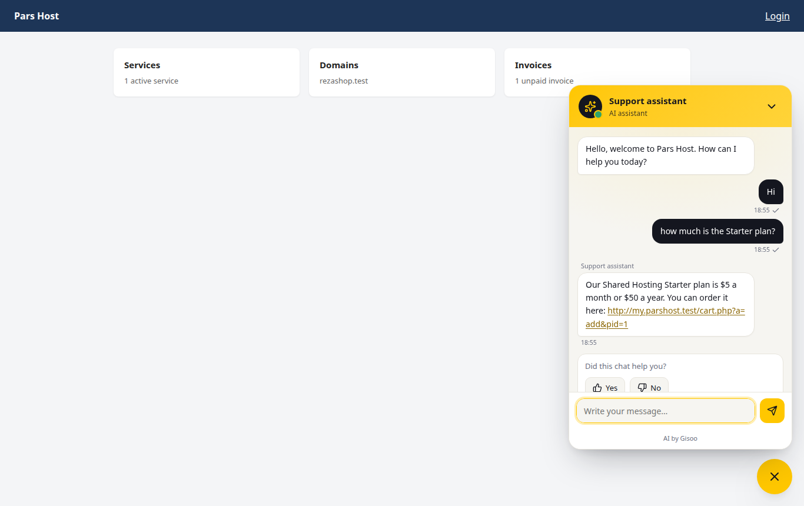
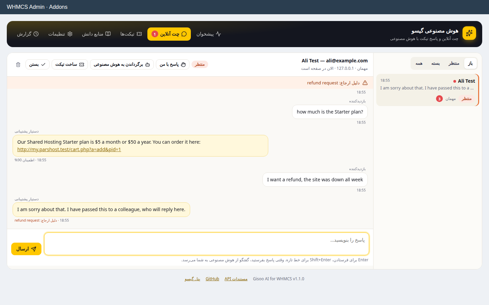
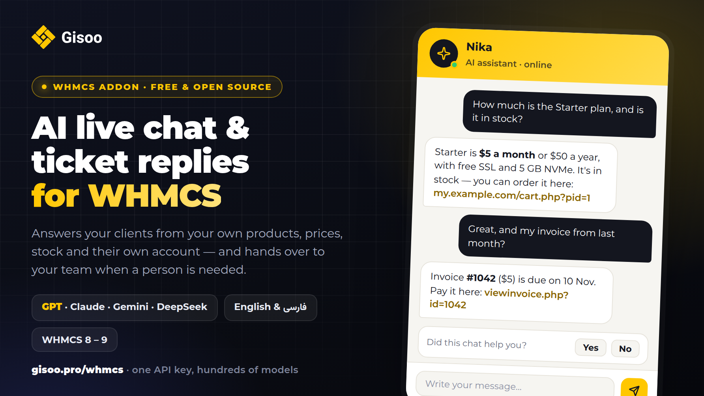
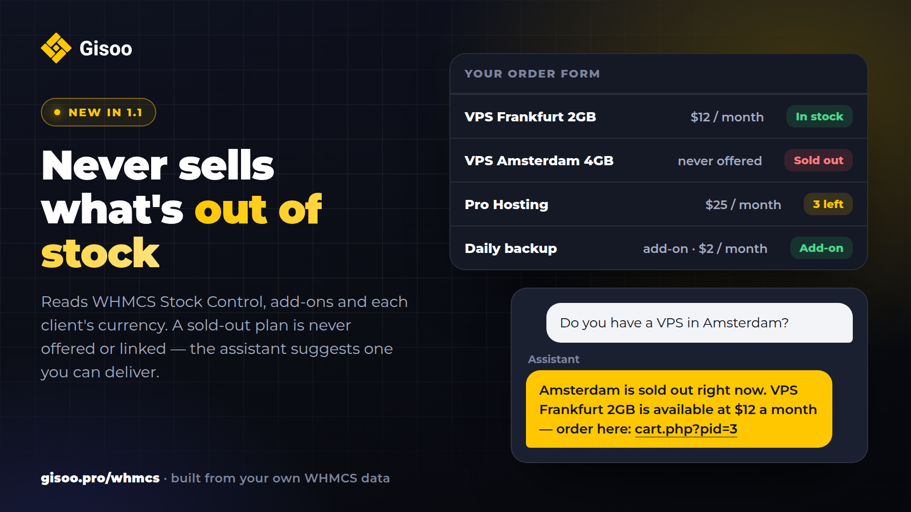
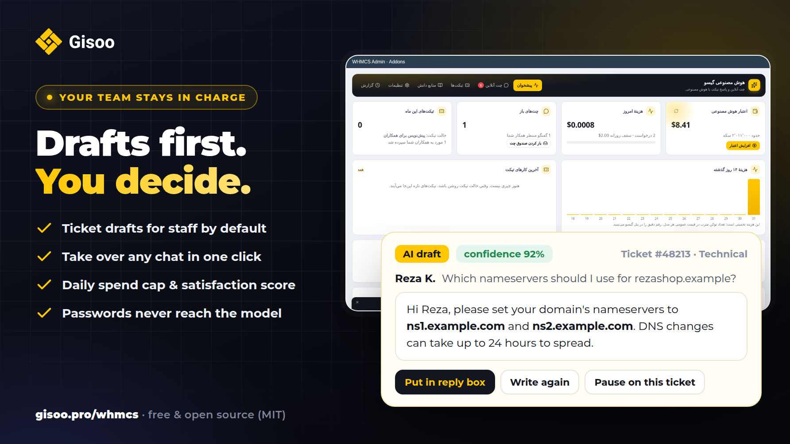
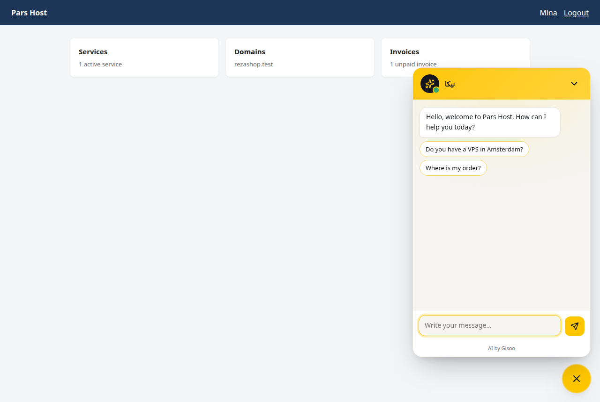
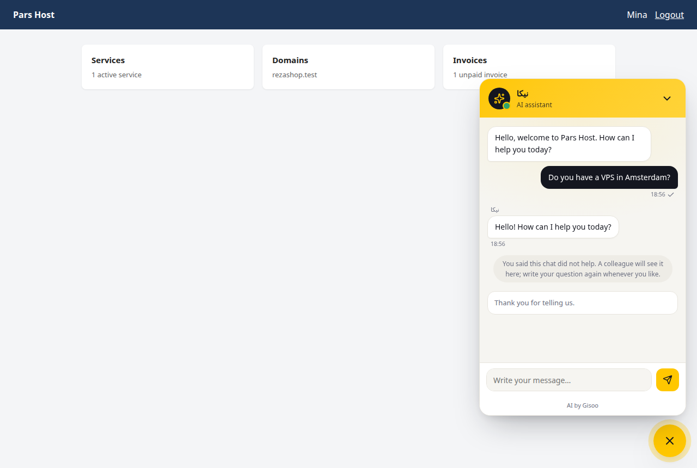

<div align="center">


# افزونهٔ هوش مصنوعی WHMCS گیسو (Gisoo AI for WHMCS)

**دستیار پشتیبانی و فروش هوش مصنوعی برای WHMCS: چت با مشتری در ناحیهٔ کاربری، پیش‌نویس یا پاسخ تیکت، و سپردن کار به همکاران شما.**

AI live chat and AI ticket replies for WHMCS, powered by the Gisoo AI API (GPT, Claude, Gemini, DeepSeek with one key). It knows your products, stock, prices and each client's own account, and shows your AI credit inside WHMCS.

[](LICENSE)
[](https://github.com/netarz/netarz-ai-whmcs/releases)
[](#requirements)
[](#requirements)
[](https://github.com/netarz/netarz-ai-whmcs/actions)

[صفحهٔ معرفی افزونه](https://gisoo.pro/whmcs?utm_source=github&utm_medium=referral&utm_campaign=gisoo-ai-whmcs&utm_content=header) · [راهنمای نصب](https://gisoo.pro/docs/whmcs?utm_source=github&utm_medium=referral&utm_campaign=gisoo-ai-whmcs&utm_content=header) · [دانلود آخرین نسخه](https://github.com/netarz/netarz-ai-whmcs/releases/latest) · [ساخت کلید API](https://gisoo.pro/app/api?utm_source=github&utm_medium=referral&utm_campaign=gisoo-ai-whmcs&utm_content=header) · [English](#english)

 

  

</div>

<a id="intro"></a>

این افزونه به WHMCS یک **دستیار پشتیبانی و فروش** اضافه می‌کند که در ناحیهٔ کاربری با مشتری‌ها چت می‌کند، تیکت‌ها را
می‌خواند و پاسخ می‌نویسد، و هر جا لازم باشد کار را به همکاران شما می‌سپارد. جوابش را از اطلاعات خود WHMCS شما
می‌گیرد: پایگاه دانش، محصولات و قیمت‌ها و موجودی آن‌ها، افزودنی‌های محصول، قیمت دامنه‌ها، اطلاعیه‌ها، اختلال‌های شبکه،
یادداشت‌هایی که خودتان می‌نویسید، و برای مشتریِ واردشده سرویس‌ها، سفارش‌ها و فاکتورهای خودش.

مدل‌ها از [وب‌سرویس هوش مصنوعی گیسو](https://gisoo.pro/api?utm_source=github&utm_medium=referral&utm_campaign=gisoo-ai-whmcs&utm_content=intro) می‌آیند: یک کلید، مدل‌های GPT، Claude، Gemini و DeepSeek، و اعتباری که
موجودی‌اش را در پیشخوان WHMCS می‌بینید.

## فهرست

- [تازه‌های نسخهٔ 1.1.0](#whats-new)
- [دو نسخه: گیسو و نِت اَرز](#editions)
- [چه می‌کند](#features)
- [نصب در پنج قدم](#install)
- [حالت‌های تیکت](#ticket-modes)
- [دستیار از کجا جواب می‌دهد](#knowledge)
- [هزینه و کنترل آن](#cost)
- [امنیت و حریم خصوصی](#security)
- [پرسش‌های رایج](#faq)
- [آزمون‌ها](#tests)
- [English](#english)

<a id="whats-new"></a>

## تازه‌های نسخهٔ 1.1.0

- **موجودی محصولات رعایت می‌شود.** اگر کنترل موجودی WHMCS (Stock Control) برای محصولی روشن باشد و موجودی‌اش تمام شده
  باشد، دستیار آن را پیشنهاد نمی‌دهد و لینک سفارشش را نمی‌فرستد؛ می‌گوید فعلاً موجود نیست و اگر محصول مشابهی موجود باشد،
  همان را پیشنهاد می‌کند. می‌توانید محصولات ناموجود را کلاً از دید دستیار پنهان کنید. وقتی فقط چند عدد مانده باشد، دستیار
  این را هم می‌داند. (این اشکال را یکی از کاربران گزارش کرد؛ ممنون از او.)
- **محصولاتی که دستیار پیشنهاد نمی‌دهد:** شناسهٔ محصول‌هایی را که فقط همکاران شما می‌فروشند در تنظیمات بنویسید.
- **افزودنی‌های محصول (Addons)** با قیمت و محصول‌هایی که به آن‌ها تعلق دارند، به دانش دستیار اضافه شد.
- **قیمت به ارز خود مشتری:** مشتری‌ای که حسابش به تومان است، قیمت‌ها را به تومان می‌بیند.
- **سفارش‌های در انتظار:** دستیار به پرسش «سفارشم چی شد؟» از روی سفارش‌های خودِ مشتری جواب می‌دهد.
- **سؤال‌های پیشنهادی:** تا چهار سؤال زیر پیام خوشامد؛ مشتری با زدن هر کدام همان را می‌فرستد.
- **نظر مشتری دربارهٔ گفتگو:** بعد از اولین جواب می‌پرسد «این گفتگو کمکتان کرد؟». جواب «نه» در صندوق گفتگوها علامت
  می‌خورد و درصد رضایت ۳۰ روز اخیر در پیشخوان افزونه دیده می‌شود.
- **انتخاب نشانی سرویس:** `gisoo.pro`، نشانی ویژهٔ ایران `ir.gisoo.pro` برای سرورهایی که در دیتاسنتر ایران هستند، یا نشانی دلخواه.
- **نسخهٔ گیسو** کنار نسخهٔ نِت اَرز منتشر شد.

 

فهرست کامل تغییرات: [CHANGELOG.md](CHANGELOG.md)

<a id="editions"></a>

## دو نسخه: گیسو و نِت اَرز

گیسو برند هوش مصنوعی نِت اَرز است. هر دو نسخه به یک حساب وصل می‌شوند: همان کلید، همان اعتبار، همان مدل‌ها.
فرق دو نسخه فقط در نام، لینک‌ها و نشانی پیش‌فرض است.

| فایل | پوشه در WHMCS | برای چه کسی |
|---|---|---|
| `gisoo-ai-whmcs-1.1.0.zip` | `modules/addons/gisoo_ai` | نصب تازه (پیشنهاد ما) |
| `netarz-ai-whmcs-1.1.0.zip` | `modules/addons/netarz_ai` | به‌روزرسانی سایت‌هایی که نسخهٔ نِت اَرز را دارند |

دو نسخه نام ماژول، کلاس‌ها و جدول‌های جدا دارند و کنار هم تداخلی ندارند. اگر از نسخهٔ نِت اَرز به نسخهٔ گیسو می‌روید،
تنظیمات و گفتگوها منتقل نمی‌شوند؛ کلید و یادداشت‌هایتان را دوباره در نسخهٔ گیسو بگذارید.

<a id="features"></a>

## چه می‌کند

**چت آنلاین در ناحیهٔ کاربری**
- پنجرهٔ چت روی همهٔ صفحه‌های ناحیهٔ کاربری، فارسی و راست‌به‌چپ یا انگلیسی، با رنگ و جای دلخواه؛ روی گوشی تمام‌صفحه باز می‌شود.
- دستیار صبر می‌کند تا مشتری پیامش را تمام کند و به چند خطِ پشت‌سرهم یک جواب می‌دهد، نه سه جواب.
- نشانگر «در حال نوشتن»، تیک «دیده شد»، سؤال‌های پیشنهادی، و گفتگویی که با بارگذاری دوبارهٔ صفحه از دست نمی‌رود.
- مهمان‌ها با نام و ایمیل، مشتری‌های واردشده بدون فرم.
- وقتی کار به همکار شما نیاز دارد (بازگشت وجه، شکایت، کاری روی حساب)، گفتگو به صف همکاران می‌رود و اگر در زمانی که تعیین
  کرده‌اید کسی جواب نداد، به مشتری پیشنهاد می‌شود گفتگو را به تیکت تبدیل کند.

**صندوق چت برای همکاران شما**
- فهرست گفتگوهای باز، منتظر و بسته؛ متن کامل گفتگو، دلیل ارجاع و نظر مشتری.
- «پاسخ با من» گفتگو را از هوش مصنوعی می‌گیرد و «برگرداندن به هوش مصنوعی» پس می‌دهد.
- پیام کوچکی در همهٔ صفحه‌های پنل مدیریت خبر می‌دهد که بازدیدکننده‌ای منتظر است.

**پاسخ تیکت**
- هر تیکت تازه و هر پاسخ مشتری، در دپارتمان‌هایی که انتخاب کرده‌اید، خوانده می‌شود.
- در صفحهٔ هر تیکت، پنل «پاسخ هوش مصنوعی» پیش‌نویس را نشان می‌دهد و با یک دکمه در کادر پاسخ WHMCS می‌گذارد.
- در حالت خودکار، فقط پاسخ‌هایی فرستاده می‌شوند که دستیار به آن‌ها مطمئن است؛ بقیه پیش‌نویس می‌مانند با یک یادداشت داخلی.
- بعد از پاسخ یکی از همکاران، دستیار روی همان تیکت کنار می‌کشد.

**اعتبار و هزینه**
- اعتبار هوش مصنوعی در پیشخوان افزونه و ابزارک صفحهٔ اصلی پنل مدیریت WHMCS.
- سقف هزینهٔ روزانه، حداقل اعتبار، و ایمیل به مدیران وقتی اعتبار کم می‌شود.
- گزارش هر درخواست با تعداد توکن، هزینهٔ تخمینی، مدت پاسخ و شناسه‌ای که با پنل شما یکی است.

<a id="install"></a>

## نصب در پنج قدم

1. فایل `gisoo-ai-whmcs-1.1.0.zip` را از [صفحهٔ نسخه‌ها (Releases)](https://github.com/netarz/netarz-ai-whmcs/releases/latest) دانلود کنید و پوشهٔ
   `modules/addons/gisoo_ai` را در همان مسیرِ نصب WHMCS خودتان بارگذاری کنید.
2. در پنل مدیریت WHMCS به **System Settings ← Addon Modules** بروید، «Gisoo AI» را فعال کنید و به نقش‌های مدیریتیِ لازم
   دسترسی بدهید.
3. در [بخش API اپ گیسو](https://gisoo.pro/app/api?utm_source=github&utm_medium=referral&utm_campaign=gisoo-ai-whmcs&utm_content=install) یک کلید بسازید (`sk-gisoo-v1-…`) و اعتبار بخرید.
4. در **Addons ← Gisoo AI ← تنظیمات** کلید را بگذارید، ذخیره کنید و «آزمایش اتصال» را بزنید. اگر سرور WHMCS شما در
   دیتاسنتر ایران است، «نشانی API» را روی `ir.gisoo.pro` بگذارید.
5. پیشنهاد: یک مدیر با نام «دستیار پشتیبانی» بسازید و در بخش تیکت‌ها انتخابش کنید تا پاسخ‌ها به نام او ثبت شوند. کران (cron)
   WHMCS باید طبق معمول هر پنج دقیقه اجرا شود.

حالت تیکت پیش‌فرض «پیش‌نویس برای همکاران» است؛ یعنی تا خودتان حالت خودکار را روشن نکنید، هیچ پاسخی بدون دیدن همکاران
شما به مشتری نمی‌رسد. پیش از روشن کردن حالت خودکار، در زبانهٔ «دانش» بخش «آزمایش دستیار» را امتحان کنید.

**به‌روزرسانی از 1.0:** پوشهٔ تازه را روی پوشهٔ قبلی بگذارید و در Addon Modules یک بار صفحه را باز کنید؛ جدول‌ها خودکار
به‌روز می‌شوند و تنظیمات، گفتگوها و نشانی API قبلی شما سر جایش می‌ماند.

<a id="requirements"></a>

**نیازمندی‌ها:** WHMCS 8.0 یا بالاتر، PHP 7.4 یا بالاتر با افزونه‌های curl، json و mbstring، و دسترسی سرور به `https://gisoo.pro`
یا `https://ir.gisoo.pro`.

<a id="ticket-modes"></a>

## حالت‌های تیکت

| حالت | چه اتفاقی می‌افتد |
|---|---|
| خاموش | دستیار تیکت‌ها را نمی‌خواند. پنل صفحهٔ تیکت هم نشان داده نمی‌شود. |
| پیش‌نویس برای همکاران (پیش‌فرض) | پاسخ در صفحهٔ تیکت آماده می‌شود؛ یکی از همکاران آن را می‌خواند، ویرایش می‌کند و می‌فرستد. |
| پاسخ خودکار | پاسخ‌هایی با اطمینانِ بالاتر از حدی که تعیین کرده‌اید فرستاده می‌شوند. شکایت، بازگشت وجه، کار روی حساب و هر چیزی که در دانش نیست، پیش‌نویس می‌ماند با یادداشت داخلی. |

در هر دو حالت فعال، برای هر تیکت می‌توانید «توقف روی این تیکت» را بزنید، یا «نوشتن دوباره» برای پیش‌نویس تازه.

<a id="knowledge"></a>

## دستیار از کجا جواب می‌دهد

دستیار برای هر پرسش، مرتبط‌ترین بخش‌های این منابع را برمی‌دارد و از جای دیگری جواب نمی‌دهد:

- **یادداشت‌های شما**: ساعت پاسخگویی، شرایط بازگشت وجه، نیم‌سرورها (Nameserver)، جواب پرسش‌های پرتکرار. این متن بر همه مقدم است.
- **پایگاه دانش** (فقط مقاله‌های عمومی) و **اطلاعیه‌های منتشرشده**.
- **محصولات و قیمت‌ها** از فرم سفارش، با لینک سفارش. محصولات پنهان، بازنشسته و مستثنا حساب نمی‌شوند و محصول ناموجود
  بدون قیمت و لینک، با برچسب «ناموجود» به دستیار می‌رسد.
- **افزودنی‌های محصول** که در فرم سفارش نشان داده می‌شوند.
- **قیمت دامنه‌ها**، فقط وقتی پرسش دربارهٔ دامنه است.
- **اختلال‌های باز شبکه** از صفحهٔ Network Status.
- **حساب مشتریِ واردشده**: سرویس‌ها، دامنه‌ها، سفارش‌های در انتظار، فاکتورهای پرداخت‌نشده و اعتبار حساب؛ فقط برای خودِ
  همان مشتری و به ارز خودش.

پرسش فارسی مقالهٔ انگلیسی را هم پیدا می‌کند («نیم سرور» → nameserver، «گواهی» → SSL و…).

<a id="cost"></a>

## هزینه و کنترل آن

هزینه همان هزینهٔ وب‌سرویس هوش مصنوعی گیسو برای مدلی است که انتخاب می‌کنید. با مدل پیش‌فرض `gpt-4o-mini`، هر پاسخ
چت یا تیکت معمولاً چند هزار توکن ورودی (بیشترش دانشِ همراه پرسش) و چند صد توکن خروجی است.

- **سقف روزانه (دلار):** وقتی پر شود، دستیار تا فردا کنار می‌کشد و گفتگوها به همکاران شما می‌رسد.
- **حداقل اعتبار:** پیش از تمام شدن اعتبار، دستیار کنار می‌کشد و حداکثر روزی یک ایمیل به مدیران می‌رود.
- **محدودیت پیام هر بازدیدکننده در ساعت** و **بلندترین پاسخ (توکن)**.

عددی که افزونه نشان می‌دهد تخمینی است (توکن × قیمت عمومی مدل)؛ رقم دقیق در پنل گیسو است.

<a id="security"></a>

## امنیت و حریم خصوصی

- کلید API رمزنگاری‌شده با `encrypt()` خود WHMCS ذخیره می‌شود و هرگز به مرورگر نمی‌رسد؛ در گزارش ماژول (Module Log) هم پوشانده می‌شود.
- از حساب مشتری فقط فهرست مشخصی از فیلدها خوانده می‌شود. رمز عبور، نام کاربری سرویس، IP سرور، IP سفارش، فیلدهای
  سفارشی و یادداشت‌های داخلی هرگز به مدل داده نمی‌شوند.
- گفتگوی هر مشتریِ واردشده فقط برای خودش باز می‌شود؛ از توکنِ گفتگو فقط هش SHA-256 ذخیره می‌شود.
- درخواست‌های نوشتنی چت سرآیند اختصاصی می‌خواهند و مبدأ (Origin) بررسی می‌شود؛ فرم‌ها و درخواست‌های پنل مدیریت توکن CSRF دارند.
- هر متنی که مشتری یا مدل می‌نویسد به‌صورت متن نمایش داده می‌شود، نه HTML.
- اگر مشتری رمزش را در چت بنویسد، دستیار تکرارش نمی‌کند و از او می‌خواهد همان لحظه عوضش کند.
- نگه‌داری گفتگوها و گزارش‌ها محدود است (پیش‌فرض ۱۸۰ روز) و کران روزانه قدیمی‌ترها را پاک می‌کند.
- غیرفعال کردن افزونه داده‌ها را نگه می‌دارد؛ برای پاک کردن کامل، دکمهٔ «پاک کردن همهٔ داده‌های افزونه» در تنظیمات را بزنید.

<a id="faq"></a>

## پرسش‌های رایج

**بدون هوش مصنوعی هم کار می‌کند؟** بله. اگر «پاسخ هوش مصنوعی در چت» را خاموش کنید، چت آنلاین مثل یک چت معمولی کار
می‌کند و همکاران شما از صندوق چت جواب می‌دهند.

**اگر اعتبار تمام شود؟** دستیار کنار می‌کشد: چت‌ها به صف همکاران می‌روند و تیکت‌ها بدون پاسخ خودکار می‌مانند.

**محصولی موجود نیست؛ دستیار چه می‌گوید؟** می‌گوید فعلاً موجود نیست، لینک سفارش نمی‌دهد و زمان موجود شدن را قول نمی‌دهد.
اگر محصول مشابهی موجود باشد، آن را پیشنهاد می‌کند. موجودی از کنترل موجودی خود WHMCS خوانده می‌شود.

**قالب ناحیهٔ کاربری من سفارشی است؛ چت کار می‌کند؟** چت از هوک `ClientAreaFooterOutput` بارگذاری می‌شود و به قالب وابسته
نیست. اگر در صفحه‌ای نمی‌خواهید دیده شود، مسیرش را در «پنهان کردن چت در این صفحه‌ها» بنویسید.

**لینک مستقیم برای شروع گفتگو دارم؟** `index.php?m=gisoo_ai` ناحیهٔ کاربری را با پنجرهٔ چتِ باز نشان می‌دهد. از جاوااسکریپت
هم `GisooChat.open()` کار می‌کند (در نسخهٔ نِت اَرز: `index.php?m=netarz_ai` و `NetArzChat.open()`).

<a id="tests"></a>

## آزمون‌ها

```bash
composer install
composer test              # 159 آزمون واحد و یکپارچگی روی یک WHMCS شبیه‌سازی‌شده (SQLite)
./build.sh test-gisoo      # همان 159 آزمون روی نسخهٔ گیسو
node tests/e2e/run.cjs     # 59 بررسی در مرورگر واقعی: ویجت، صندوق چت، پنل تیکت، تنظیمات، موبایل فارسی، موجودی و نظرسنجی
EVAL_API_KEY=sk-… php tests/eval/run.php   # 15 سناریوی واقعی مشتری با مدل واقعی
./build.sh all             # ساخت هر دو فایل zip
```

WHMCS نرم‌افزار تجاری است و در این مخزن نیست. آزمون‌ها کد واقعی افزونه را روی لایهٔ پایگاه دادهٔ خود WHMCS
(Illuminate Capsule)، جدول‌های WHMCS و `localAPI`ای اجرا می‌کنند که همان هوک‌های WHMCS را صدا می‌زند.

## مخزن‌های دیگر

- [گیسو](https://github.com/netarz/gisoo): اپ فارسی برای گفت‌وگو با مدل‌های هوش مصنوعی، ساخت تصویر، ویدیو، موسیقی و صدا، و وب‌سرویس سازگار با OpenAI و Anthropic. [gisoo.pro](https://gisoo.pro/?utm_source=github&utm_medium=referral&utm_campaign=gisoo-ai-whmcs&utm_content=related)
- [افزونهٔ وردپرس هوش مصنوعی](https://github.com/netarz/netarz-ai-wordpress): همین دستیار برای وردپرس و ووکامرس.
- [نمونه‌کد وب‌سرویس هوش مصنوعی](https://github.com/netarz/ai-api-examples): Python، Node.js، PHP، Laravel، cURL، LangChain، n8n و ربات تلگرام.

<a id="support"></a>

## مشارکت و پشتیبانی

- **اشکال در افزونه:** یک [Issue](https://github.com/netarz/netarz-ai-whmcs/issues/new/choose) باز کنید و نسخهٔ WHMCS و PHP و نتیجهٔ «آزمایش اتصال» را هم بنویسید.
- **رفع اشکال، ترجمه یا امکان تازه:** Pull Request بفرستید. پیش از آن [راهنمای مشارکت](CONTRIBUTING.md) را ببینید.
- **حساب، کلید و اعتبار:** از پنل گیسو تیکت بزنید یا به `info@gisoo.pro` ایمیل بفرستید.
- **مشکل امنیتی:** در Issue عمومی ننویسید؛ طبق [سیاست امنیتی](SECURITY.md) به `dev@netarz.ir` بفرستید.

مجوز: MIT ([LICENSE](LICENSE)) · [آیین رفتار](CODE_OF_CONDUCT.md)

---

<a id="english"></a>

## English

**Gisoo AI for WHMCS** adds an AI support and sales assistant to WHMCS. It chats with visitors in the client area, reads and
answers support tickets, and hands over to your staff whenever a person is needed. It answers only from your own WHMCS: the
public knowledgebase, products with their prices and stock, product add-ons, domain prices, announcements, open network
issues, the notes you write, and — for a signed-in client — that client's own services, domains, pending orders and unpaid
invoices, in the client's own currency.

It runs on the [Gisoo AI API](https://gisoo.pro/api?utm_source=github&utm_medium=referral&utm_campaign=gisoo-ai-whmcs&utm_content=english)
(OpenAI-compatible: GPT, Claude, Gemini, DeepSeek with one key) and shows your remaining AI credit on the WHMCS dashboard.

### New in 1.1.0

- **Stock-aware selling.** With WHMCS Stock Control on, a sold-out product is never offered or linked: the assistant says it
  is not available right now and suggests an in-stock alternative. You can also hide sold-out products from it entirely, and it
  knows when only a few are left. (Reported by a user — thank you.)
- **Products the assistant never offers**, by product ID.
- **Product add-ons** with their prices and the products they belong to.
- **The client's own currency** for prices, and **pending orders** in the client context.
- **Suggested questions** under the greeting; a visitor clicks one to send it.
- **Chat ratings**: "Did this chat help you?" after the first answer; a "no" is flagged in the inbox and the dashboard shows
  30-day satisfaction.
- **API address choice**: `gisoo.pro`, `ir.gisoo.pro` for servers in Iranian data centres, or a custom address.
- **A Gisoo edition** next to the NetArz one.

### Editions

Gisoo is NetArz's AI brand: the account, key, credit and models are the same, and any key works in either edition.

| File | Folder in WHMCS | For |
|---|---|---|
| `gisoo-ai-whmcs-1.1.0.zip` | `modules/addons/gisoo_ai` | new installs (recommended) |
| `netarz-ai-whmcs-1.1.0.zip` | `modules/addons/netarz_ai` | updating sites that run the NetArz edition |

The two editions use separate module names, classes and tables, so they never collide. Moving from one to the other does not
carry settings or conversations across.

### Install

1. Download `gisoo-ai-whmcs-1.1.0.zip` from [Releases](https://github.com/netarz/netarz-ai-whmcs/releases/latest) and upload
   `modules/addons/gisoo_ai` into your WHMCS installation.
2. **System Settings → Addon Modules**: activate *Gisoo AI* and grant access to the admin roles that need it.
3. Create an API key (`sk-gisoo-v1-…`) in the [Gisoo app](https://gisoo.pro/app/api?utm_source=github&utm_medium=referral&utm_campaign=gisoo-ai-whmcs&utm_content=english) and add credit.
4. **Addons → Gisoo AI → Settings**: paste the key, save, then *Test connection*. On a server in an Iranian data centre, set
   *API address* to `ir.gisoo.pro`.
5. Recommended: create an admin user called "Support assistant" and choose it under Tickets so AI replies carry that name.
   Keep the WHMCS cron running every five minutes.

Requirements: WHMCS 8.0+, PHP 7.4+ with curl, json and mbstring, outbound HTTPS to `gisoo.pro` or `ir.gisoo.pro`.

The ticket mode starts as **drafts for staff**: nothing reaches a customer unseen until you switch automatic mode on. Try the
*Test the assistant* console under Knowledge first.

**Updating from 1.0:** upload the new folder over the old one and open Addon Modules once; the tables are upgraded and your
settings, conversations and API address are kept.

### Security and privacy

- The API key is stored with WHMCS's own `encrypt()`, never sent to the browser, and masked in the module log.
- Only a fixed list of client fields is read. Passwords, service usernames, server and order IPs, custom fields and admin
  notes never reach the model.
- A signed-in client's conversation opens for that client only; only a SHA-256 of the visitor token is stored.
- Chat writes require a custom header and a same-origin check; admin forms and AJAX calls carry a CSRF token.
- Everything a visitor or the model writes is rendered as text, never HTML.
- If a customer types a password into the chat, the assistant never repeats it and tells them to change it.
- Conversations and logs are pruned after the retention period (default 180 days). Deactivating keeps your data;
  *Remove all module data* in Settings deletes it.

### Tests

`composer test` runs 159 unit and integration tests against a WHMCS stand-in (WHMCS's own Illuminate Capsule on SQLite, the
WHMCS tables the module reads, and a `localAPI` that fires the same hooks WHMCS fires); `./build.sh test-gisoo` runs the same
suite against the Gisoo edition. `node tests/e2e/run.cjs` drives the widget, the staff inbox, the ticket panel and the settings
in headless Chrome (59 checks). `tests/eval/run.php` runs 15 real customer scenarios against a real model. WHMCS itself is
commercial software and is not part of this repository.

### License

[MIT](LICENSE). Lucide icons are inlined under the ISC licence.
